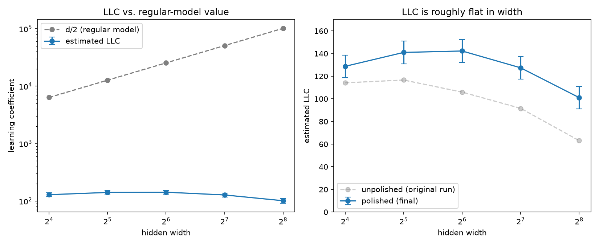

# The Local Learning Coefficient of MNIST Networks
**Overview.** Singular learning theory (SLT) takes into account zero eigenvalues in the Fisher information matrix which make learning models singular. These zero modes signal the presence of symmetries in singular models, implying they live in an effective lower dimensional space. The effective dimensionality of the model is also known as the learning coefficient $\lambda$, is asymptotically related to the value d/2 in the regular (non-singular) models, where d is the number of parameters. In a nutshell, singular learning theory claims that the width of minima must also be considered. For example a wide valley vs a narrow valley. The wider valley has a greater volume around the minimum, representing a large set of states the model can occupy. This larger set of possible states likewise increases the entropy of the system, lowering the overall free energy, yielding an optimal state. More symmetry -> wider minima -> lower free energy. SLT begins to explain why models do not necessarily overfit. More parameters does not imply a higher effective dimensionality or $\lambda$ of the model. Learning systems like to keep it simple (small $\lambda$).

**Derivations** The partition function of a learning system is given in Bayesian terms as 
$$Z(n\beta) =\int\prod_{ij} dw_{ij} e^{-n\beta S(w_{11}, w_{12}... w_{ij})}$$
where $S(w) = L_n(w) - \frac{1}{n\beta}\ln(\phi(w))$, $L_n(w)$ is the loss function, $\phi(w)$ is the prior distribution. The partition function gives the global statistical behavior of all $w_{ij}$. Taking the limit of an infinite number of $w_{ij}$ renders $Z$ analogous in structure to a Euclidean space path integral with action $S(w)$ being a function of all possible weights w:

$$Z(n\beta) = \int \mathcal{D}w e^{-n\beta S[w]}$$

Likewise, the free energy of the system is given by 

$$F(n\beta) = -\ln(Z(n\beta)) \approx n\beta L_n(w^*) +\lambda\ln(n\beta).$$

where $w^*$ is the minimizing weight configuration. The approximation is a first order asymptotic expansion in the limit $n\beta \to \infty$. The analogous average energy of the system is given as 

$$\langle E \rangle =-\partial_\beta \ln Z \approx  nL_n(w^*) + \frac{\lambda}{\beta}.$$

Then using $\partial_\beta F(\beta) = -\frac
{Z'}{Z} = n E[L_n(w)]$ gives 

$$ \lambda \approx n\beta (E[L_n(w)] - L_n(w^*)). $$

The inverse temperature $\beta$ is set to $\beta = \frac{1}{\ln n}$ ensuring that $n\beta \to \infty$ and $\beta \to 0$ as $n \to \infty$. 


**Question.**  How does the estimated $\lambda$ of a trained MNIST classifier compare with d/2 as the network gets wider?

**Result.** As $d/2$ grows from 6,365 to 101,765, the estimated $\lambda$ stays roughly flat at 100–140. The ratio $\frac{\lambda}{(d/2)}$ falls from 2% to 0.1%: the added width contributes almost no effective complexity, giving a possible explanation of the model's generalizability.



*Left: $\lambda$ against the regular-model value d/2 (log scale). Right: $\lambda$ against width, for final (polished) models and the original unpolished run. Error bars are ±10, the realistic uncertainty from the seed and polishing checks.*

## Setup

- **Model:** a two-layer network, 784 → width → 10 with ReLU, trained on MNIST with Adam for 10 epochs. Widths 16, 32, 64, 128, 256, so d = (784+1+10)·width + 10.
- **Estimator:** the local learning coefficient (Lau et al., 2023),

  $\lambda \approx n\beta ( E[L_n] − L_n(w^*) )$ with $n\beta = \frac{n}{\ln n},$

  where $w^*$ are the trained weights and $p(w) \propto e^{−n\beta L_n(w) − \frac{\gamma}{2}|w − w^*|²}$
- **Sampler:** stochastic-gradient Langevin dynamics (SGLD), written in [`llc.py`](llc.py)

  with $\epsilon = 10^{-5}, \gamma = 100$, batches of 512, 4 walks of 6,000 steps, and the first 2,500 discarded as burn-in.

## Validation

On linear regression (a regular model with d = 11), where the true value is $d/2 = 5.5$, the estimator gives **$\lambda \approx 5.4$** ([`check_linear.py`](check_linear.py)).

## Checks

Each check changed a choice that shouldn't matter and asked whether the result survived.

| Check | Finding |
|---|---|
| **Step size** | $\lambda$ grew with $\epsilon$, but runs with the same total time $\epsilon \times steps$ agreed, so the walks were too short, not overshooting. Equilibration takes ≈ 2/(εγ) = 2,000 steps. |
| **Equilibration** ([`check_plateau.py`](check_plateau.py)) | $\lambda$ computed over a moving window plateaus after $\approx$ 2,000 steps (width 16) and $\approx$ 2,500–4,000 (width 256). Burn-in set to 2,500. |
| **Training seed** ([`robustness.py`](robustness.py)) | Retraining with a second seed shifts $\lambda$ by 8–9, a more honest error bar than the spread between walks (1–3). |
| **Localization $\gamma$** | $\gamma = 300$ lowers every $\lambda$ (it cuts off weakly curved directions), but the width-256 model gave $\lambda = −1.0$, which is impossible. |
| **Negative $\lambda$ → polishing** ([`polish.py`](polish.py)) | A negative $\lambda$ means the walk found loss *below* w\*, so w\* wasn't at a minimum. Polishing (5 more epochs at learning rate 1e-4) made every early offset positive and raised $\lambda$ at width 256 from 63 to 106. |
| **Training length** ([`polish_more.py`](polish_more.py)) | Polishing width 256 further keeps lowering the loss (0.0029 → 0.0018) while the weight norm creeps up and λ drifts down (106 → 95). |

The polishing check changed the story. The original run showed $\lambda$ dropping from 115 to 63 with width, but most of that drop was an artifact of the wide models not being at a minimum.

## Final results ([`final_run.py`](final_run.py))

All five widths, polished the same way, estimated at γ = 100:

| width | $d/2$ | $\lambda$ | $\lambda / (d/2)$ |
|---|---|---|---|
| 16 | 6,365 | 129 | 2.0% |
| 32 | 12,725 | 141 | 1.1% |
| 64 | 25,445 | 142 | 0.56% |
| 128 | 50,885 | 127 | 0.25% |
| 256 | 101,765 | 101 | 0.10% |

## What this shows, and what it doesn't

- **Robust:** $\lambda <d/2$ at every width, seed, and training length.
- **Robust:** $\lambda$ does not grow monotonically with width, and in an idealized situation $\lambda$ could potentially converge to constant with respect to the true dimensionality of the system.
- **Caveats:**
  - $\lambda$ has a $\gamma$ dependence. 
  -  For width 256, training longer keeps lowering the loss (−20% over 5 epochs) while $\lambda$ drifts down (106 → 95). Once the model classifies nearly every training image correctly, making its weights bigger keeps lowering the loss, so training never settles at a fixed w*, so its $\lambda$ depends on when training stops.

## Reproduce

```bash
pip install torch torchvision matplotlib
python train.py          # train the five widths -> models/
python check_linear.py   # validate the estimator (~30 s)
python final_run.py      # polish + estimate all widths -> results_polished.json
python plot_results.py   # figure (also needs results.json from run_llc.py)
```

Long runs take 1–3 hours on an Apple-silicon laptop (MPS). Seeds are fixed, so reruns reproduce the numbers.

## Files

| File | Purpose |
|---|---|
| `model.py` | the `DigitNet` network |
| `train.py` | train and save the five widths |
| `llc.py` | the SGLD LLC estimator |
| `check_linear.py` | validation on linear regression |
| `run_llc.py` | LLC of the original (unpolished) models |
| `check_plateau.py` | $\lambda$ over time, to check equilibration |
| `robustness.py` | $\gamma$ and seed checks |
| `polish.py`, `polish_more.py` | polishing checks |
| `final_run.py` | final polished results |
| `plot_results.py` | the figure |

## References

- S. Watanabe, *Algebraic Geometry and Statistical Learning Theory*, Cambridge University Press (2009).
- S. Watanabe, "A Widely Applicable Bayesian Information Criterion," *JMLR* 14, 867–897 (2013).
- E. Lau, Z. Furman, G. Wang, D. Murfet, S. Wei, "The Local Learning Coefficient: A Singularity-Aware Complexity Measure," [arXiv:2308.12108](https://arxiv.org/abs/2308.12108).

*Seth Grable*
